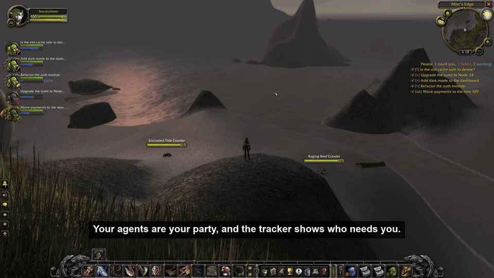
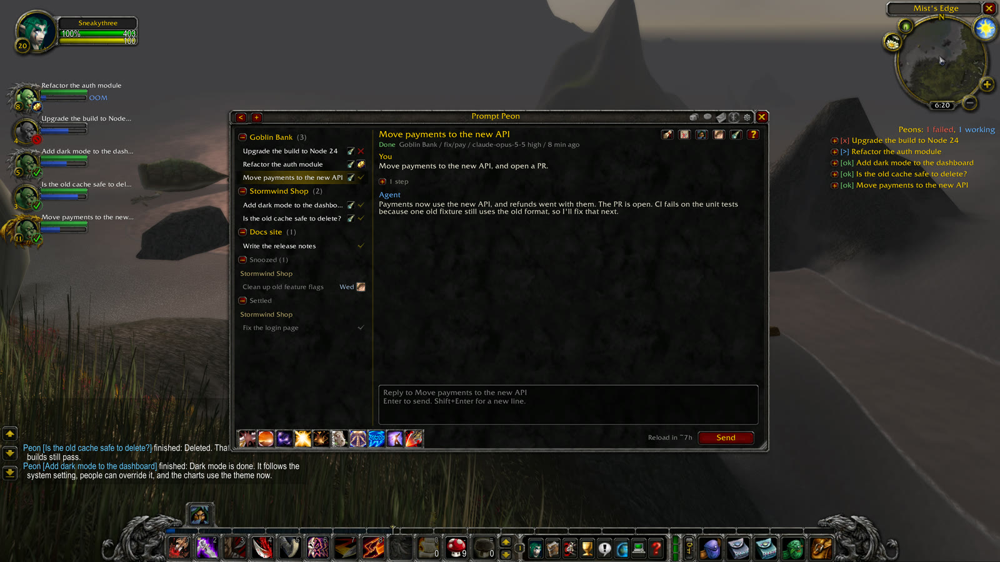
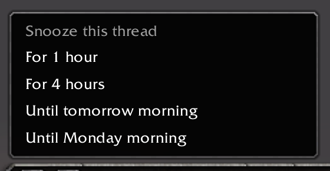
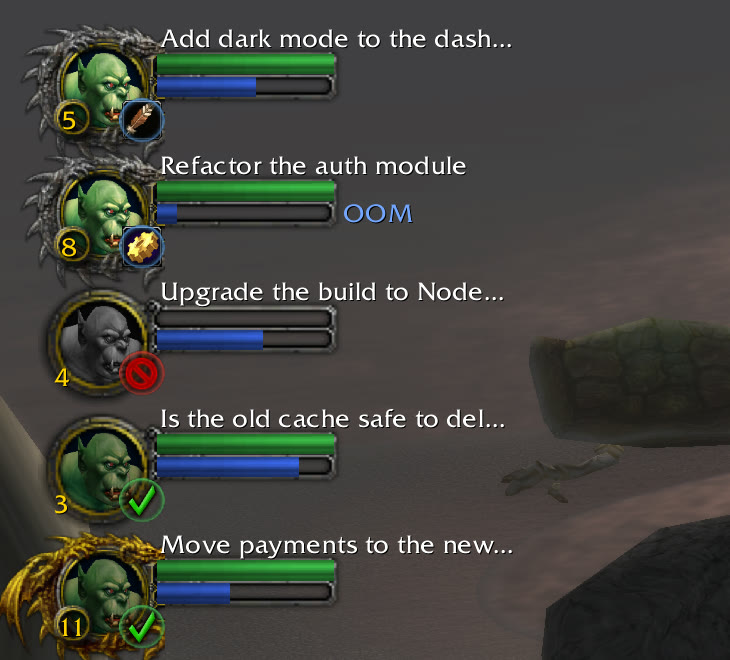
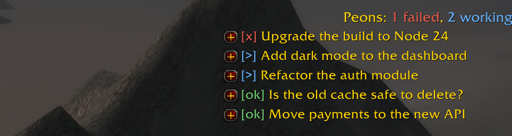
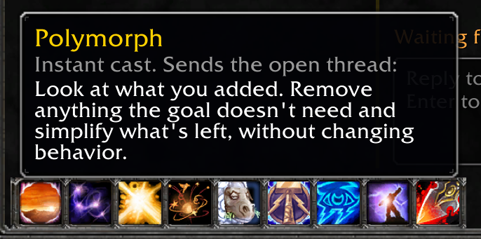
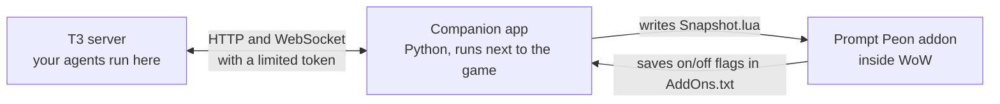

# Prompt Peon

*"Something need doing?"*

**Your [T3 Code](https://t3.codes) agents, inside World of Warcraft.** Threads become quests and agents become your party. Read every reply and answer it without leaving the game, and hear a peon say "Work complete!" when one finishes.

For Classic Era, retail and WoW Forever. Free and open source.

## What you get

**A quest log.** `/peon` opens every thread under its project, with the whole conversation: messages, tool steps, todo lists, questions and pictures.

**Real controls.** Reply, steer, start, stop, snooze and turn in. See what a thread changed in a colored diff, the subagents it sent out, and its pull requests with their CI. Approvals stay in T3.

**A party.** A tracker shows who needs you, and each agent gets a portrait: peons for the Horde, peasants for the Alliance, the undead for the Forsaken, or whichever you pick. Health shows how the turn is going, mana is how much context is left, and if you turn on **Elite frames** in Options, veterans earn silver and gold dragons.

**The fun part.** Each of these tells you something true about the work:

- The peon talks: "Work, work" when an agent starts, "Work complete!" when it finishes. Click it too many times and it gets annoyed.
- Finished work drops loot, sized by the change.
- Failed agents die. Resurrect them, or release their spirit.
- An agent nearly out of context says "I need more mana". Evocation compacts it.
- Spells send a useful prompt: Holy Light (prove it works), Dispel Magic (stop going in circles), Polymorph (simplify). They're real orders to a real agent, so each one shows its exact words and asks first.

[docs/USING.md](docs/USING.md) has all of it.

## Install

You need WoW and T3 Code. On Windows the installer gets Python for you. On Linux you need Python 3.14 or newer.

1. Read [the warning below](#before-you-use-it). Then download `prompt-peon-<version>.zip` from [the newest release](https://github.com/svenmeys/prompt-peon/releases/latest), and from nowhere else, and unpack it.
2. Close WoW, and start the installer:
   - **Windows:** double-click `install.cmd`. If Windows warns about a downloaded file, press **More info**, then **Run anyway**.
   - **Linux or Steam Deck:** open a terminal in that folder and run `sh install.sh`.
3. Answer its questions. If your threads are on another machine, it asks for a link from that machine. When unsure, the safe answer is no.
4. Start the game and type `/peon`.

Chat tells you when there's a new version. To update, run the installer again: it gets the newest release by itself. To turn the companion app off or on, double-click `start-stop.cmd`, or run `sh start-stop.sh` on Linux. **[The install guide](docs/INSTALL.md)** covers every route, what to do when something goes wrong, and how to remove it.

## What it is, and what it isn't

| It is | It isn't |
| --- | --- |
| A remote control for T3 Code. Your agents keep running on your T3 machine | An AI in the game. No model runs inside WoW |
| An addon, plus a small companion app that runs next to the game | Just an addon. WoW addons can't reach the network, so the companion app does that part |
| Local. Nothing you type goes through Blizzard's servers | A multiplayer feature. Nothing is shared with your guild or party |
| Only a window and some sounds | A bot. It can't play your character, and it doesn't read your game |

## Before you use it

> **Use it at your own risk.** This is free software with no warranty ([MIT](LICENSE)). Blizzard's license forbids third-party software it hasn't expressly authorized, it hasn't authorized this, and it can suspend or close an account without notice. Other addons with companion apps are common, but the way this one gets data in and out of the game is unusual, so we can't promise how Blizzard will treat it. Don't use it on an account you can't afford to lose.

- **Other addons can see it.** WoW gives every addon the same access. Addons you trust can read what Prompt Peon shows. Addons you haven't trusted get thread names and status only, and sending stays off while one is installed.
- **Nothing stays behind.** The companion app clears thread text, drafts and unsent messages from the game folder when you close the game. Your token never goes in that folder.
- **Sends are real.** A reply or spell reaches a real agent, which can change your code and use your quota, and a misclick counts. Agents with full access stay read-only from the game unless you say yes.

[docs/USING.md](docs/USING.md#know-this-before-you-use-it) has the full list. [docs/SECURITY.md](docs/SECURITY.md) says what protects you and what you have to watch. [docs/COMPANION-APP.md](docs/COMPANION-APP.md) lists everything the companion app touches.

## Status

Early. So far one person has used it.

| Setup | State |
| --- | --- |
| Classic Era 1.15.9 on a Steam Deck (Proton, Desktop Mode), T3 on another machine | Works, tested in the real game |
| Retail 12.1.5 on a Steam Deck | Runs in the real game: the log, live updates, party frames and tracker. Sending from the game isn't tested there yet |
| WoW Forever 1.60.1 | Installs and shows in the character screen's addon list, but not yet run in the game, because its servers aren't open |
| Windows | Installed and used by the author. A full check is still to come |
| Reaching T3 on another machine | An SSH tunnel is in daily use. T3 Connect is tested from a Mac, and a full run from Windows is still to come. Tailscale hasn't run through the installer |
| Steam Deck Gaming Mode | Not tested |
| macOS | Not supported |

Tested against T3 nightly 0.1.7. T3's remote API isn't public, so a T3 update can break this. If it does, the game tells you, and the threads you had stay on screen until it's fixed.

## More

- [docs/USING.md](docs/USING.md): every feature, refreshes, and what to do when something goes wrong
- [docs/INSTALL.md](docs/INSTALL.md): every install route and question
- [docs/ARCHITECTURE.md](docs/ARCHITECTURE.md): how it fits together
- [CONTRIBUTING.md](CONTRIBUTING.md): outside code isn't the goal right now, but here are the rules if you still want to send a change

## License and credits

[MIT](LICENSE). [IBM Plex Mono](https://github.com/IBM/plex) ships unmodified under the SIL Open Font License: see `addon/PromptPeon/IBMPlexMono-LICENSE.txt`. The peon's voice and every icon come from your own game client, so none of Blizzard's files ship here.

World of Warcraft is a trademark of Blizzard Entertainment. Prompt Peon isn't affiliated with Blizzard or with T3.
