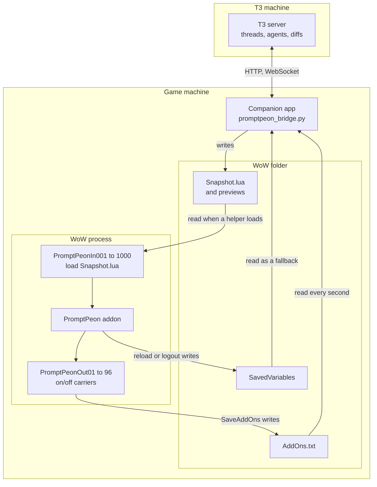
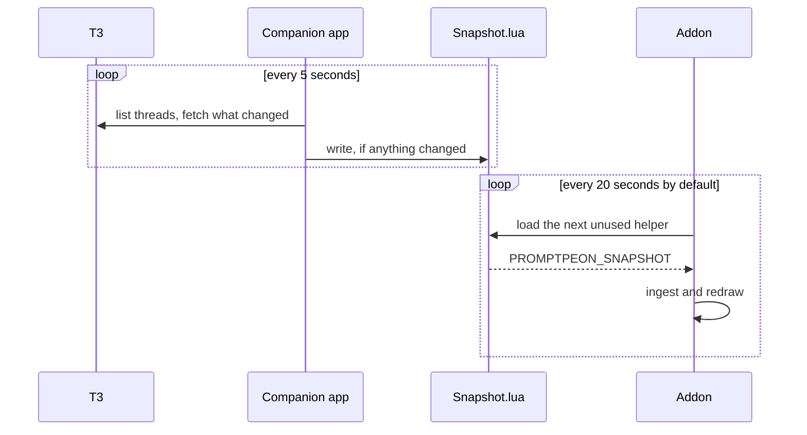
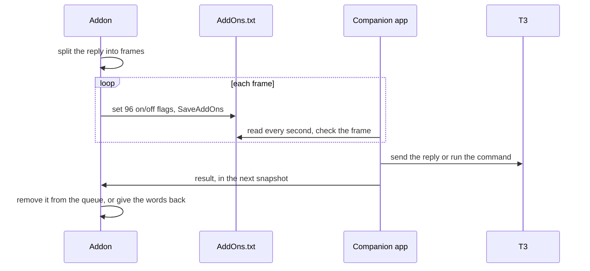

# Architecture

How Prompt Peon gets live data into a game that has no network, and gets your replies back out. Read this to change the code, or to judge the design. For what the companion app touches on your machine, read [COMPANION-APP.md](COMPANION-APP.md).

## The problem

A WoW addon runs in a sandbox. It can't open a socket, can't read a file and can't start a program. The only things it writes to disk are its saved settings, at reload or logout, and the list of enabled addons. T3 Code runs an API on another process, often another machine.

So nothing inside the game can reach T3. Something outside the game has to, and the two sides have to talk through the few files the game itself reads and writes.

## The pieces

*Only the companion app touches the network. Everything between it and the game is a file on the game machine.*

| Piece | Where | What it does |
| --- | --- | --- |
| Companion app | `bridge/promptpeon_bridge.py` starts it and `bridge/promptpeon/` holds it. Standard library only | Talks to T3, writes the snapshot, reads what the game wrote, and makes every real security decision |
| `Core*.lua` | Addon | Loads snapshots, queues and sends replies, reads delivery results |
| `UI*.lua` | Addon | The log window, tracker, party frames and Options |
| `Chat.lua` | Addon | What it says in chat, clickable links, and the `/peon` command |
| `Game*.lua` | Addon, optional | Levels, health, loot, achievements, spells and the away report. The addon still works without these files |
| In helpers | `PromptPeonIn001` to `1000`, generated at install | Empty addons whose only job is to load `Snapshot.lua` |
| Out helpers | `PromptPeonOut01` to `96`, generated at install | Empty addons whose on/off state carries bits |

## Into the game

A LoadOnDemand addon reads its files from disk at the moment it loads. So a helper whose `Data.lua` points at `Snapshot.lua` picks up whatever the companion app last wrote. On Linux that pointer is a symlink. On Windows it's a hard link, which is why Windows rewrites the file in place instead of replacing it.

*The two loops don't wait for each other. The file is the only link between them.*

The catch is that each helper only loads once per UI session. That makes refreshes a budget: 1,000 of them, reset by a UI reload. The pace trades freshness against reloads:

| State | Default wait between loads |
| --- | --- |
| Log open | 20 seconds, 10 to 60 in Options |
| Log closed, agents working or waiting on you | 1.5 times the open pace |
| Log closed, nothing happening | 90 seconds |
| Waiting for something you just asked for | 5 seconds |
| In combat | Paused |

A load takes about 6 ms on the Steam Deck, measured once, so the cost of going faster is reloads and not frame rate.

**What's in a snapshot.** `Snapshot.lua` is one assignment, `PROMPTPEON_SNAPSHOT = {...}`, rendered by `lua_value()` so that text stays data. It holds up to 30 open threads in `threads`, up to 30 settled plus every snoozed thread in `pk`, delivery results in `ack` and `res`, and the model list in `md`. Things you opened, like a diff, ride along for 60 seconds, and the addon keeps them. `sid` and `rv` let the addon ignore an older write from the same run. `at` shows the companion app is alive, so unchanged data is still rewritten every 30 seconds.

Snoozed and settled threads ride in their own list so that the tracker, party frames and counts never see them.

**Pictures.** The game only sees files that exist when the UI loads, but it reads a file's new pixels the first time it's shown. So the installer creates 64 picture files up front, and the companion app overwrites them in turn with a converted PNG. A session has 64 pictures, and a reload frees more.

## Out of the game

An addon can't write a file on demand, with one exception: `C_AddOns.SaveAddOns()` writes the enabled state of every addon to `AddOns.txt` immediately. So 96 helper addons act as 96 bits.

*Each frame carries 10 bytes plus checks. A short reply arrives in under a second, and a send step costs about 1 ms in the game.*

If that path stalls, the reply stays queued in SavedVariables as `PromptPeonOutbox`, and a UI reload delivers it. Each message has a sequence number, and the companion app only acts on a number once, so a retry can't send twice.

A command is a message that starts with byte `0x01`, which no keyboard can type into a reply. That's how a typed message can never become a command.

## Commands

| Verb | What it does | Counts against the limit of 10 a minute |
| --- | --- | --- |
| A plain message | Replies. A busy agent gets it as its next turn | Yes |
| `stop`, `settle`, `unsettle` | Stop a run, turn a thread in, bring it back | Yes |
| `snooze`, `unsnooze` | Put a thread to sleep until a time, or wake it | Yes |
| `new`, `newm` | Start a thread in the approval mode you picked | Yes |
| `setmodel` | Pick model and effort for the next turn | Yes |
| `steer`, `cancelq`, `editq` | Change a queued message | Yes |
| `diff`, `file`, `agents`, `older`, `view`, `pr` | Fetch something to read | No, they have their own limit of 60 a minute |
| `hidden` | Tell the companion app what you hid | No |

Everything is refused while an addon you haven't trusted is installed, because the game can't tell which addon sent it. Thread text stays out too: `publish` keeps only names and status on each row and adds `lk`, the plain sentence the game shows. The one exception is hiding more, which only takes things away. Replies, `steer`, `editq` and `setmodel` to an agent with full access are refused too, unless you said yes at install. So is `new` or `newm` in a mode that can act without asking: a mode you can't send to is a mode you can't start.

Messages have sequence numbers for delivery. If a second WoW account lands on a number the first already used, each result carries a checksum of the thread and words it belongs to, so the addon sees it isn't theirs and sends again under a new number.

## When things fail

The rule: never let a failure read as "all your agents are idle", and never lose what you wrote.

| What failed | What happens |
| --- | --- |
| T3 unreachable | The last threads stay on screen with a notice, and replies wait in the queue |
| T3 answers in a shape we don't know, or a call it no longer has | The same, with a plain "T3 changed" notice. It recovers by itself |
| One thread in a new shape | That thread shows without new messages. The rest carry on |
| Token expired | A notice that says to make a new link |
| A reply is refused | The words go back in your reply box |
| The companion app died while sending | It checks T3 for the message on restart, and says "unknown" rather than guess |
| A snapshot load fails | The old snapshot stays. Commands stay in the queue |
| Out of refreshes | Updates stop and the log asks for a reload. It never reloads by itself |
| The game closes | The companion app clears thread text from the game folder and stops talking to T3. A last reply still goes, and the folder stays clear. Then it removes drafts and unsent messages from the saved file and its `.bak`. If one couldn't be sent, `clr` tells the next session how many |
| T3 sends something huge or endless | Every answer has a size and time limit, and the snapshot has an 8 MB budget. Past it, the threads updated longest ago show a note to read them in T3 |

T3's remote API isn't public. `tests/check_t3_contract.py` asks a real T3 whether it still understands every call we make: each command names a thread that doesn't exist, so T3 refuses it, and the check tells "refused" apart from "didn't understand". Run it after every T3 update.

## Decisions, and what we didn't do

- **Warned reloads, not an unlimited channel.** Research found no proven way to read unlimited fresh data inside the game. A sound-file flag could make reloads rarer, but it isn't proven and adds load to the game.
- **1,000 helpers.** More helpers mean fewer reloads. The addon list and login were checked by hand at 1,096 and feel normal. All helpers sit under one collapsible heading.
- **One T3 server per install.** T3 doesn't share threads between machines. Two servers in one companion app would be about 150 to 300 lines, and nobody has needed it yet.
- **No approvals from the game.** Answering an agent's permission request stays in T3.
- **Addons share one Lua state.** Nothing inside the game can tell our code from another addon's, so every real check lives outside it, in the companion app. The addon's questions and limits protect you from mistakes, not from another addon. See [SECURITY.md](SECURITY.md).
- **Small files, one package.** Every file does one job and says so at the top. Addon files stay flat in one folder, because the installer checks that folder against an exact list. A new addon file only loads after a full game restart, so the installer asks you to close the game.
- **Standard library only.** No dependency to install, audit or keep updated, on either side of a double-click installer.

## Where things are

**The addon,** in the order the game loads it:

| Files | What they do |
| --- | --- |
| `Core.lua` | Shared numbers, state and text helpers |
| `CoreMarkdown.lua` | Markdown into drawable blocks |
| `CoreIngest.lua` | Reads snapshots and delivery results, and works out which threads show |
| `CoreNotice.lua` | Voices, sounds and banners when a thread changes state |
| `CoreRefresh.lua` | Refresh pacing, and warnings about problems and reloads |
| `CoreEncode.lua`, `CoreSend.lua` | Frames and checksums, the reply queue, send pacing |
| `CoreStartup.lua` | Saved settings, timers, the key binding |
| `Chat.lua` | Chat lines, links and the command |
| `UI.lua` | Only what the `UI*` files share |
| `UITracker.lua`, `UIParty.lua` | The tracker and party frames |
| `UIFrame.lua`, `UILayout.lua` | Builds the window, its size, fonts and opacity |
| `UIList.lua` | The thread list |
| `UIDetail.lua`, `UICanvas.lua`, `UIMessages.lua` | The right pane: its pieces, the drawing surface, and message rows |
| `UIChanges.lua`, `UIPullRequests.lua`, `UIPages.lua` | The diff, pull request, report, new thread, achievement and agent pages |
| `UIControls.lua`, `UIMenus.lua`, `UIOptions.lua`, `UIReply.lua` | Buttons and popups, menus, Options, the reply box |
| `UIRender.lua` | Draws everything |
| `Game.lua`, `GameAway.lua`, `GameLoot.lua`, `GameAchievements.lua`, `GameSpells.lua` | Levels and mana, the away report, loot, achievements, spells |

**The companion app,** in `bridge/promptpeon/`:

| Modules | What they do |
| --- | --- |
| `settings`, `console`, `userconfig` | Limits and folders, the only home of `VERSION`; the log; config and token |
| `luadata`, `gametext`, `safefiles` | Writing data as Lua, text the game can draw, file writes that never follow a link |
| `pngtga`, `previews` | Pictures for the game |
| `savedvars`, `frames` | Reading what the game wrote |
| `websocket`, `t3errors`, `t3remote`, `catalog` | Talking to T3 |
| `threadstate`, `timeline`, `pullrequests`, `diffs`, `snapshots` | Turning what T3 says into what the game shows |
| `bridgestate`, `gates`, `refreshing`, `publishing`, `commands`, `delivery`, `loop` | Running: state, the safety gates, one refresh, what each game command does, the main loop |
| `processes`, `wowfolder`, `addonfiles`, `prompts`, `pairing`, `installer`, `uninstaller`, `autostart`, `updater`, `cli` | Installing, connecting, updating and removing |

## Tests

| Test | What it proves | What it can't prove |
| --- | --- | --- |
| `tests/test_addon.lua` | Addon logic, against a stubbed client | That anything draws correctly |
| `tests/test_bridge.py`, which runs `tests/bridge/` | Companion app logic, with fakes and a real HTTP server for failure paths | How T3 really answers |
| `tests/test_e2e.py` | The installer and send path on real Linux and Windows machines in CI, with a fake T3 and game folder | The real game |
| `tests/check_api.py` | Every WoW template and global exists in Blizzard's UI source, on every client | That it behaves as expected at runtime |
| `tests/check_t3_contract.py` | A real T3 still understands every call | Run by hand, not in CI, because CI has no T3 |

Drawing is only ever proven by looking at the real game. Every feature's proof is a screenshot from it.
