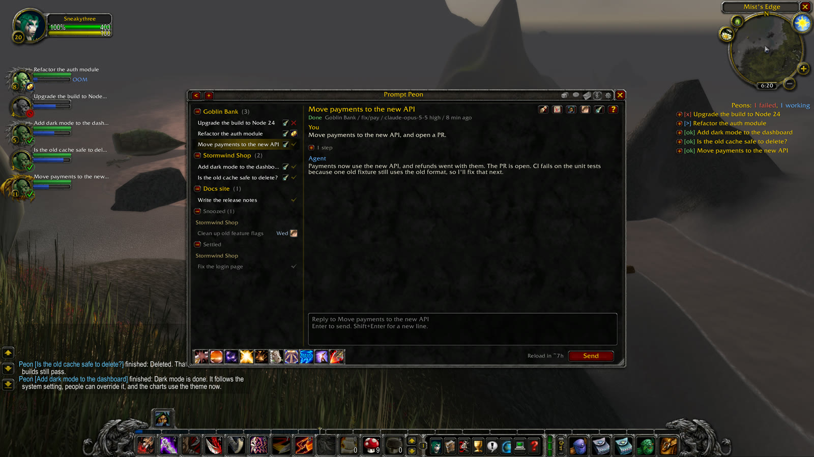

# Install and set up Prompt Peon

This guide takes you from nothing to your threads in WoW's quest log. It takes about five minutes, plus a minute or two if T3 runs on another machine.

You need:

- **WoW:** Classic Era, retail or WoW Forever, on Windows, Linux or SteamOS.
- **T3 Code:** running on the machine your threads are on, which can be a different machine from the game.
- **Python 3.14 or newer on the game machine.** On Windows the installer gets it for you if it's missing or older. On Linux and SteamOS you install it yourself.
- **The game closed** while you run the installer.

## 1. Pick your route

The companion app talks to exactly one T3. **Pick the machine your threads are on, not the machine you're sitting at.**

| Where your threads are | Route | What you need |
| --- | --- | --- |
| On the game machine | [Same machine](#same-machine) | Nothing extra |
| On another machine, and you reach it through T3 Connect | [T3 Connect](#t3-connect) | T3 Connect on, and Python 3.10+ on the T3 machine |
| On another machine on your Tailscale network | [Tailscale](#tailscale) | Tailscale on both machines |
| On another machine you can reach over SSH | [SSH tunnel](#ssh-tunnel) | An SSH server on the game machine, and no T3 running there |

**If you have T3 on your game PC and use it to view threads on another machine,** that's still the T3 Connect or Tailscale route. The T3 app can show threads from several machines, but the T3 on your game PC only holds that PC's own threads. If you take the same-machine route by mistake, you'll see those local threads or none at all.

## 2. Download it

Do this on the game machine. For the T3 Connect route, do it on the T3 machine too.

1. Open [the newest release](https://github.com/svenmeys/prompt-peon/releases/latest), and get it from nowhere else. A changed copy could do anything on your machine, and you couldn't tell by looking.
2. Under **Assets**, download `prompt-peon-<version>.zip`.
3. If you want to check it, download `SHA256SUMS.txt` too, and compare its number with what this prints in the folder you downloaded to:
   - **Windows:** `certutil -hashfile prompt-peon-<version>.zip SHA256`
   - **Linux or SteamOS:** `sha256sum prompt-peon-<version>.zip`
   - **Mac:** `shasum -a 256 prompt-peon-<version>.zip`
4. Unpack the ZIP into a new folder. On Windows, right-click it and choose **Extract All**, because the installer won't work from inside the ZIP preview.

## 3. Connect to T3

### Same machine

There's nothing to do here. Make sure T3 is running, and go to [step 4](#4-run-the-installer). The installer finds T3 by itself.

### T3 Connect

The link has to be made on the machine your threads are on, not the one you play on. If that machine is a Mac or Linux box, the easy way is to ask an agent in a T3 thread there:

> Download github.com/svenmeys/prompt-peon into a temporary folder, run `python3 bridge/promptpeon_bridge.py link` there, and give me the link it prints.

Or do it yourself:

1. Check that T3 Connect is on. Run `~/.t3/bin/t3 connect status` and look for `Other devices can reach this machine`.
2. Open a terminal in the folder you unpacked, and run:
   ```
   python3 bridge/promptpeon_bridge.py link
   ```
3. Copy the link it prints, which looks like `https://.../pair#token=...`.

The link works once, for 15 minutes. Whoever has it can read your threads and send to them, so don't paste it anywhere public. An agent's link passes through its model provider, so use that link straight away. If it runs out, make another.

This command can't find T3 Connect on a Windows T3 machine yet. Use Tailscale there.

### Tailscale

1. Sign in to Tailscale on both machines with the same account.
2. On the T3 machine, run this. It doesn't restart T3, and your agents keep running:
   ```
   ~/.t3/bin/t3 pair --tailscale --ttl 15m
   ```
3. Copy the link it prints. It works once. Without `--ttl` it only lasts 5 minutes.

### SSH tunnel

This is how a Steam Machine can reach a Mac. It makes T3 look local to the game machine, so that machine must not be running T3 itself.

1. On the T3 machine, start the tunnel and leave it running. Replace `game-machine` with yours:
   ```
   ssh -N -R 127.0.0.1:3773:127.0.0.1:3773 game-machine
   ```
2. On the T3 machine, run `~/.t3/bin/t3 pair` and copy the link it prints.

If the tunnel stops, the game loses T3. Start the tunnel again and the companion app reconnects by itself.

## 4. Run the installer

On the game machine:

- **Windows:** double-click `install.cmd` in the unpacked folder.
- **Linux or SteamOS:** open a terminal in the unpacked folder and run `sh install.sh`. On SteamOS, use Desktop Mode.

When it asks, paste your link, or press Enter if your threads are on this machine. There are no commands to copy.

**If Windows warns about a downloaded file,** press **More info**, then **Run anyway**.

If you have more than one WoW client, you choose which ones get Prompt Peon, and the companion app follows whichever game you open. The installer shows only the questions that apply to you, in this order. If you're not sure, the safe answer is no.

| It asks | What it decides | If you say no |
| --- | --- | --- |
| `Type the numbers you want` | Which WoW clients get Prompt Peon, when you have more than one. Press Enter to keep the ticked ones | It's only a choice of clients. Any you untick have Prompt Peon removed |
| `Turn pictures on?` | Whether screenshots from threads show in the game. The companion app can then fetch any picture on the T3 machine that it's asked for, not only ones in your projects | Everything else still works |
| `Press Enter to use this machine, or paste the link:` | Which T3 to use, when it finds one on this machine | Pressing Enter uses this machine's T3 and only its threads |
| `Press Enter to keep it, or paste a link to connect to another machine:` | Whether to stay connected, when you run it again | Pressing Enter keeps the connection you have |
| `WoW is open. Close it, then press Enter:` | Nothing. The installer can't change the addon while the game has it open | It stops if WoW is still open |
| `Is it your own machine, or one you trust?` | Whether to use the link. Whoever runs that machine can read what you send and put words in your game | Nothing changes |
| `Do you trust all of them with that?` | Whether to allow sending while your other addons are installed, because WoW lets any addon read and send what Prompt Peon does | The game shows thread names and status but no thread text, and sending stays off, until the addon is gone or you say yes |
| `Let the game send to and start agents with full access?` | Whether the game can send to, or start, agents that can change anything on the T3 machine without asking. Any addon you trust could then do it too | You can read them, stop them and turn them in, but not send to them or start new ones. Agents that ask first aren't affected |

**It worked if** it ends with these lines. The number of threads should match the machine you meant to connect to:

```
Connected to T3 at https://... 12 open threads.
Installed the addon and 1096 helper entries.
The companion app is running, and starts with Windows from now on.

Done. Start the game, or restart it if it is open, and type /peon.
```

## 5. Start the game

1. Start WoW. On the character screen, open **AddOns** and make sure **Prompt Peon** is ticked. You'll see over a thousand entries with names like `PromptPeonIn001`. Those are how live updates reach the game, so leave them all on.
2. Enter the world and type `/peon`.

**It worked if** the log opens with your threads on the left.



*The log, shown with demo threads. Yours lists your own.*

3. To check that sending works too, type a reply to a thread you don't mind talking to and press Enter. It should appear in T3 on the other machine. This sends a real message to a real agent.

## 6. Change your mind later

**In the game,** the cogwheel on the log opens Options, with settings such as the thread list, quest tracker, party frames, chat news, text size and refresh speed. News such as finished threads and loot goes in its own `Peon` chat tab, which you can move to your main chat or turn off there.

**To connect to a different T3,** double-click the installer again and paste a link from there. Pressing Enter keeps the one you have. The installer keeps a copy of itself in `%LOCALAPPDATA%\prompt-peon` on Windows, or `~/.local/share/prompt-peon` on Linux, so you don't need the download.

**For anything else in the installer,** run it again with one of these. On Windows, click the File Explorer address bar in the folder, type `cmd` and press Enter first:

| Add this | To |
| --- | --- |
| `--pictures` or `--no-pictures` | Turn pictures on or off. Turning them on may ask for a new link |
| `--full-access` or `--no-full-access` | Allow or stop sending to and starting agents with full access |
| `--client era`, `--client retail` or `--client forever` | Add that client without being asked. To remove one, run the installer and untick it |
| `--no-update` | Use the copy you ran, without asking GitHub for a newer one |
| `--wow-dir "path"` | Use a WoW folder it can't find. The path ends in `_classic_era_`, `_retail_` or `_forever_` |

## Update

When there's a new version, the game says so in chat. It doesn't update by itself.

1. Close WoW.
2. Run the installer again: `%LOCALAPPDATA%\\prompt-peon\\install.cmd` on Windows, or `sh ~/.local/share/prompt-peon/install.sh` on Linux and SteamOS. It gets the newest release from GitHub by itself, keeps your link and your answers, and asks only what it needs to.
3. Start the game.

Game patches take care of themselves. If T3 updates and something stops working, get the newest Prompt Peon.

## If it doesn't work

| What you see | What it means | What to do |
| --- | --- | --- |
| Only your local threads, or `No open threads` | The companion app is connected to the T3 on this machine, or that T3 is empty | Get a link from the machine your threads are on, run the installer again and paste it. A plain Enter keeps the T3 you have |
| `T3 said no to that link (403)` | The link was used already or ran out | Make a new one and run this again |
| `Can't reach T3 at ...` | The T3 machine is asleep, or not reachable from here | Wake it and check its network. For T3 Connect, check `t3 connect status` on that machine |
| `Waiting for the companion app.` in the log | The game can't see the companion app | Close the game, run the installer again and start the game |
| `Could not find that WoW client.` | WoW is somewhere unusual | Run the installer with `--wow-dir` |
| `Windows would not let us change the addon files.` | WoW is still open | Close WoW and run it again |
| `Couldn't get the newest version` | GitHub couldn't be reached, so the installer carries on with the copy you ran | Nothing, unless you need the newest one. Then check your connection and run it again |
| `Could not install Python by itself.` | winget didn't manage it | Install Python from [python.org](https://www.python.org/downloads/) and run it again |
| `Prompt Peon needs Python 3.14 or newer` | This machine's Python is too old, which is likely on a Mac | Install a newer one from [python.org](https://www.python.org/downloads/) |
| `Couldn't find T3 Connect running here.` | You ran it on the machine you play on, T3 Connect is off, or that machine runs Windows | Run it where your threads are. Turn T3 Connect on in T3's settings, or use Tailscale |
| `Could not set up the addon files` | WoW is on a drive without hard links, such as FAT32 or exFAT | Move WoW to an NTFS drive and run the installer again |

Problems once it's running are in the [the usage guide](USING.md#when-something-goes-wrong).

**To check the connection without the game,** run:

```
Windows:  py -3 -I "%LOCALAPPDATA%\prompt-peon\bridge\promptpeon_bridge.py" status
Linux:    python3 -I ~/.local/share/prompt-peon/bridge/promptpeon_bridge.py status
```

**If you ask someone for help,** send the installer's text and a screenshot. Never send the `token` file or your `WTF` folder. The token is your T3 access, and `WTF` can hold unsent messages.

## Remove it

1. Close WoW.
2. Run `uninstall.cmd` on Windows, or `sh uninstall.sh` on Linux, and answer `y`. That takes out the addon, the companion app, your token and all saved data.
3. In T3, go to Settings, then Sharing & access, and revoke Prompt Peon. Deleting files doesn't cancel the access T3 gave.

## What to know about each route

| Route | Encrypted | Who can use a stolen token | How long the token lasts |
| --- | --- | --- | --- |
| Same machine | Stays on the machine | Anyone on that machine | 1 year |
| T3 Connect | Yes | Anyone, from any network | 30 days |
| Tailscale | Yes | Anyone on your Tailscale network | 30 days |
| SSH tunnel | Yes, between the machines | Anyone on the game machine while the tunnel runs | 30 days |

When a token runs out, the installer or the log says your link has expired. Make a new link and run the installer with `--link`.

The rest is in [Know this before you use it](USING.md#know-this-before-you-use-it) and [SECURITY.md](SECURITY.md).
