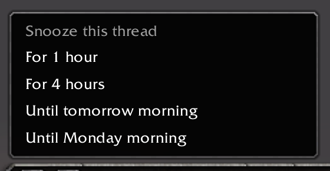
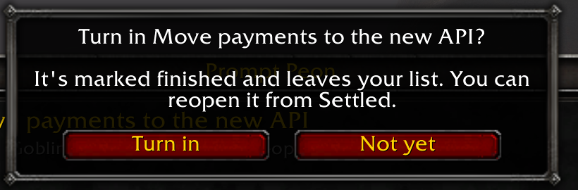
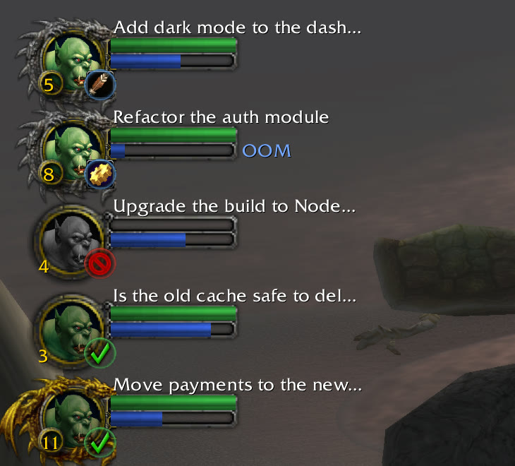
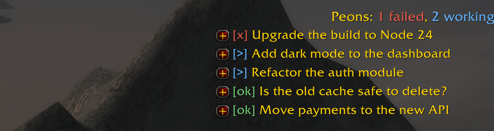
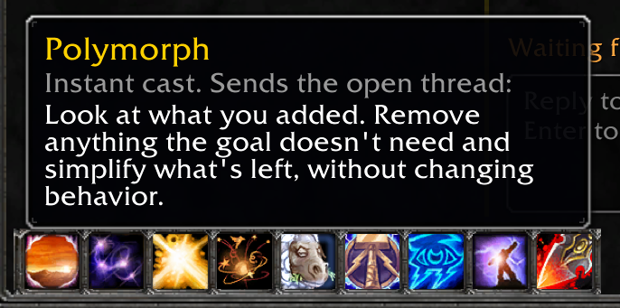

# Using Prompt Peon

Everything the [README](../README.md) keeps short: what each part does, how refreshes work, what to do when something goes wrong, and what to know about privacy. `/t3` works everywhere `/peon` does.

## What you get

**A quest log.** `/peon` opens a two-pane window. Threads sit under their project with a mark on the right, in the game's own icons:

| Mark | Meaning |
| --- | --- |
| Gold check | Done. Fades once you've read it |
| Yellow `?` | Asking you a question or for a permission |
| Red X | Failed. Fades once you've read it |
| Activity icon | Working: an eye for thinking, a gear for running a command, and so on |
| Sleep icon and a time | Snoozed until then |
| Spyglass | On your tracker |

**The whole thread.** Messages in full, tool steps, todo lists, open questions and pictures an agent looked at. Thinking stays folded until you click it. "Show older messages" fetches the rest when you ask. A link to another thread shows that thread's name, and clicking it opens the thread here, delegated ones too.

**Real controls.** The open thread has a row of small icons with a tooltip on each. Model and effort sit beside the reply box.

The icons, from the left: Changes, Agents, Hide, Snooze, Track, Stop. Turn in takes Stop's place once the agent has finished.

- **Reply** from the box under the open thread.
- **Steer, edit or cancel** a message that's still queued.
- **Changes:** what a thread changed, file by file, in a colored diff.
- **Agents:** the subagents a thread sent out, what they were asked and what they came back with.
- **Pull requests:** every PR linked to a thread, with its state, CI, review and line counts. Click one to read its summary, checks, its own changed files, discussion and timeline. Bot comments stay folded until you ask. Reading only: you reply on GitHub.
- **Snooze** a thread until later, and **turn in** a finished one. Both move to a group at the bottom of the list, under their project. Turn in asks first. Nothing in the game tells an agent to push.

**A party.** A tracker shows who needs you and plays a sound when a thread starts waiting on you. A worker stands in for each agent: a peon for the Horde, a human peasant for the Alliance, the undead for the Forsaken, or whichever you pick in Options. Options can hide them. Its level is how many turns it has finished, on a rising curve (turn 100 is level 10). Turn on **Elite frames** in Options and level 5 earns a silver dragon, level 10 a gold one. Health is how this turn is going: each failed step costs some, and a failed run kills it. Mana is its context left.

**The fun part.** Each of these tells you something true about the work:

- The peon talks: "Work, work" when an agent starts, "More work?" when it takes the next queued message, "Work complete!" when it finishes. Click it too many times and it gets annoyed.
- Finished work drops loot, sized by the change. Click it to open the thread.
- Failed agents die. You can resurrect them, or release their spirit. Keep trying and it counts your corpse runs.
- An agent nearly out of context says "I need more mana", with the game's red error. Evocation compacts it.
- The dice and coin at the top are Need and Greed: click for the next thread waiting on you, or the next finished one you haven't read.
- Spells send a useful prompt, like Holy Light (prove it works), Dispel Magic (stop going in circles) or Polymorph (simplify). They're real orders to a real agent, so each one shows you its exact words and asks first. Options can turn that question off.
- While CI is failing on a thread's open PR, Sunder the Build joins the spell bar. It tells the agent to read the real logs and fix the cause.

- Come out of a dungeon, log back in or reopen the log after a while, and it tells you what your agents did. The letter icon by the cogwheel brings that report back, and lights up when there's a new one.
- There are achievements, behind the seal icon beside it.

## Tracking and hiding

`/peon` opens or closes the log, and so does `/t3`. Everything else has a button.

A new install starts with your first five open threads on the tracker. After that, agents go on it when they start working, and stay there like a quest until you turn them in or stop tracking them. Options can hide the tracker, and alerts still come. In the log, shift-click a thread to track it, and right-click a thread or project for its options. Hide what you don't want on screen: hidden things move to a Hidden section at the bottom, and leave the tracker, party frames, counts and alerts. To bring something back, open Hidden and press the eye beside it.

## Reloads, and how fresh it is

The game can only read new data a limited number of times, so live updates run out after a while. A reload resets that. It reloads your whole UI, not just this addon, takes a few seconds, and you lose nothing. It never happens by itself. The bottom of the log, beside Send, always shows roughly how long is left. With 30 minutes to go, a Reload UI button appears. With 10 minutes to go, chat tells you too.

You choose the pace in Options, under Updates, from 10 to 60 seconds. Faster means reloading more often. Opening diffs and sending messages use some updates too, so these times are the most you'd get:

| Refresh every | Log open | Log closed, agents working |
| --- | --- | --- |
| 20 seconds (default) | About 5.5 hours | About 8 hours |
| 10 seconds | About 2.8 hours | About 4 hours |

With the log closed and nothing happening, it refreshes every 90 seconds, which lasts about a day. The game pauses updates during combat.

## When something goes wrong

| What you see | What it means | What to do |
| --- | --- | --- |
| No data from the companion app yet, or it has gone quiet | The game can't see the companion app | Close the game, run the installer again, start the game |
| Can't reach T3 at ... | The T3 machine is asleep, or not reachable from here | Wake it, or check its network. It reconnects by itself |
| Your link to T3 has expired | Links from another machine last 30 days | Make a new link in T3 and run the installer again |
| T3 answered in a way this version doesn't understand | T3 probably updated | Get the newest Prompt Peon and run the installer again |
| It says an addon isn't trusted yet, and thread text is missing | An addon you haven't trusted appeared. Names, status, the tracker and the party keep working | Close WoW, run the installer again and say yes. Or remove that addon |
| Something "has been changed, so it could be something else now" | One of Prompt Peon's own folders has something in it that the installer didn't put there | Run the installer again. It repairs it |
| This agent has full access, and sending to those from the game is off | That's the safe default | Reply from T3, or run the installer again and say yes |
| Starting agents that can act without asking is off | The same answer covers starting them | Start it in T3, pick another mode, or run the installer again and say yes |
| Prompt Peon doesn't know that approval mode | The game is still running the addon from before an update | Type `/reload`, then try again |
| Reload UI button, or a reminder in chat | Live updates are running low | Press it when it suits you |

## Know this before you use it

WoW gives every addon access to the same things, and nothing can change that from inside the game. So:

- **Addons you trust can see what Prompt Peon shows.** Your thread text and any diff you open sit in plain text in the addon folder while the game runs, where any addon can read them. The companion app clears them when you close the game, along with your drafts and any message that hadn't been sent.
- **Addons you haven't trusted get thread names and status, and nothing else.** WoW can't stop an addon reading what's in the game, so the companion app keeps the words out until you've said yes. They can still draw a line or a popup that looks like ours, or use up refreshes, so don't install addons you don't trust at all.
- **Sending from the game stays off while an addon you haven't trusted is installed,** because any addon could send through Prompt Peon. Add a new addon later and thread text and sending both stop until you run the installer again. Trust works by folder name, so a trusted addon's update is trusted too. Only trust addons you would hand the keys to.
- **Hiding is a privacy curtain, not a safe.** Hide a thread or project and its words, pictures and anything you opened leave the game at once, though a picture the game has already shown stays in its memory until the next reload, but its title and status stay, so you can find it again. Don't hide something whose title is the secret.
- **Secrets get a safety net, not a guarantee.** Files like `.env`, `.envrc` and `*.pem` stay out of diffs, and text that looks like a key or password is replaced with `[hidden secret]`. Plenty of secrets don't look like one, so don't show your screen to strangers. Don't send your `WTF` folder to anyone while the game is open: it can hold your drafts and unsent messages until it closes.
- **A plain `http://` link isn't encrypted.** Anyone on that network can read your threads and take your T3 access. Only say yes on a network you trust completely, and never on shared wifi. The installer asks first. An SSH tunnel or Tailscale avoids it.
- **Your token never goes in the game folder.** It stays in your user config folder, and only ever goes back to the T3 address that gave it to us. On the same machine it lasts a year. You can revoke it in T3 at any time.
- **Pictures** an agent looked at need file reading on the T3 machine, which is off unless you say yes at install. Say no and the companion app never asks for that permission. A token you made by hand keeps whatever access it was made with. Images attached to messages work either way.
- **News goes in its own `Peon` chat tab:** finished threads, levels, loot and the like. In Options you can move it to your main chat or turn it off. What you ask for, and anything that goes wrong, always shows in your main chat.
- **Chat shows only the start of a finished agent's message,** because other addons and chat logs keep what chat shows. The log has all of it. Your own replies stay out of chat.
- Model and effort apply from a thread's next turn, and higher effort uses more of your quota.
- **Answer an agent's question right in the log.** Each answer is a line you click, with what it means under it, and "Something else" lets you type your own. Pick one for each question, then click Send your answer. A question with more than 4 parts or more than 10 answers still has to be answered in T3, and the log says so.
- **New threads start in the approval mode you pick** on the New thread page: Supervised until you pick another, and your pick stays. Auto and Full access need the same yes as sending to those agents. Approvals themselves have to be answered in T3, and that stays that way.
- This hasn't been reviewed by Blizzard, and Blizzard can change what addons may do.

[SECURITY.md](SECURITY.md) says what protects you and what you have to watch.

**Known limits:** drafts don't survive closing the game, though they do survive a reload. Pictures over 4K don't get a preview. Up to 30 open threads and the 30 most recently settled show at once. Settled and snoozed threads open without pictures or older history. A single message over about 300,000 characters ends with a note to read the rest in T3. Two WoW accounts can share an install, but what you hid is shared too, and the account that changed it last wins.
